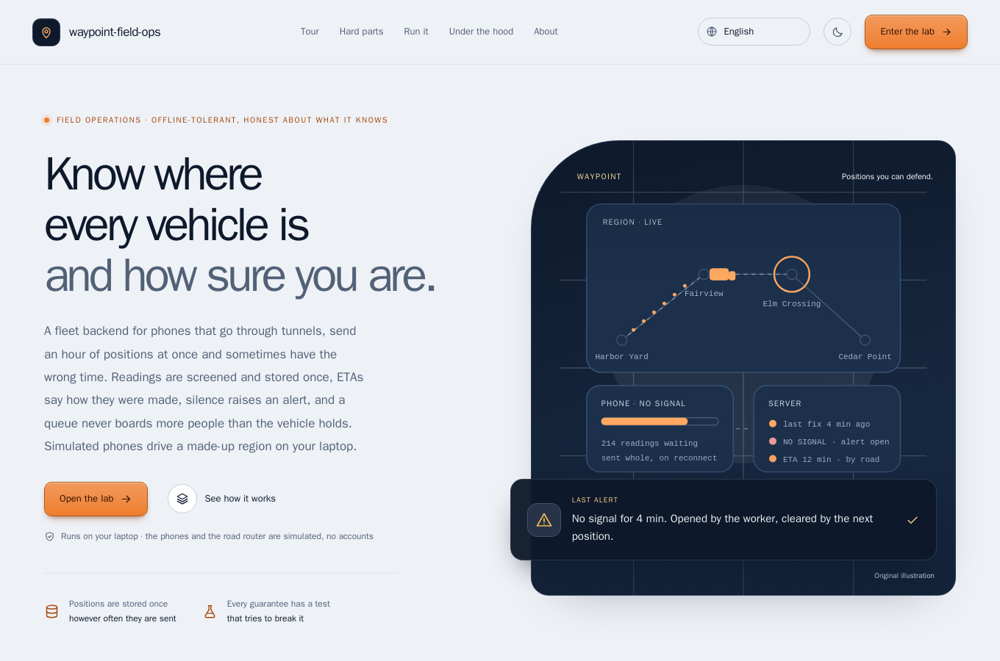
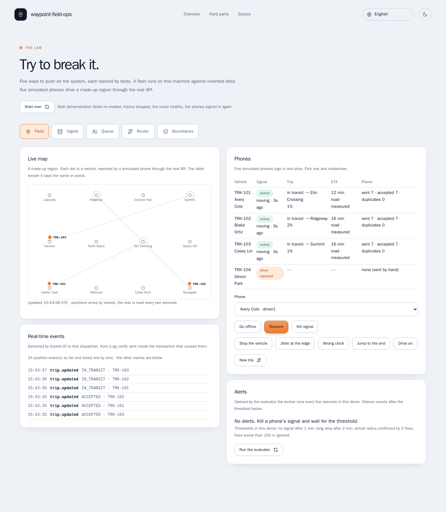
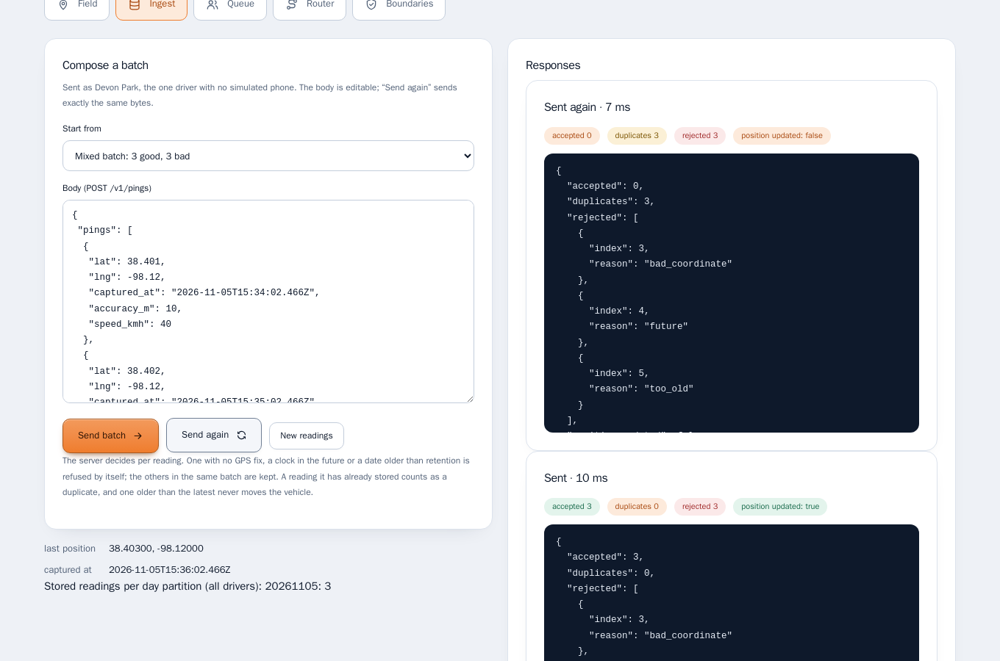
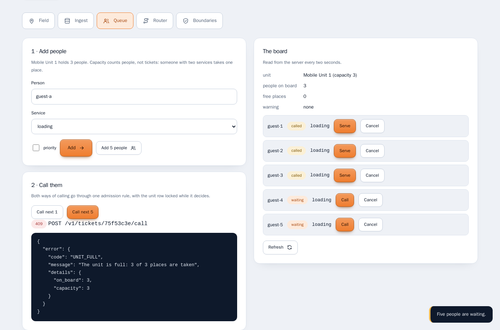
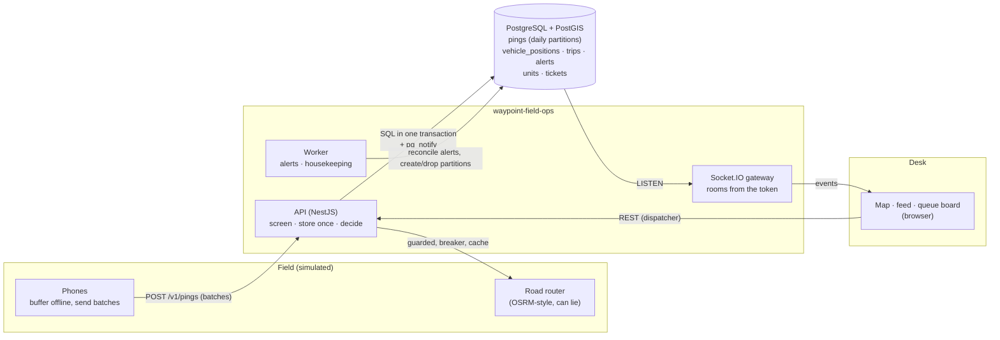
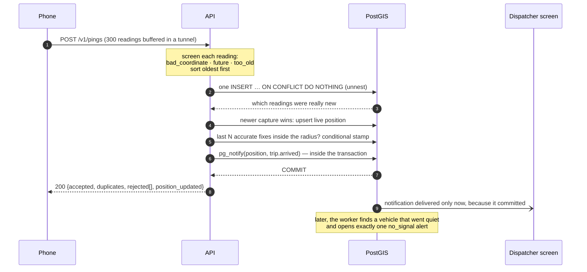

# waypoint-field-ops

> A fleet backend for **phones that lose signal, send an hour of positions at once and sometimes have the wrong time.**
> Readings are **screened and stored once**, an ETA **says how it was computed**, silence **raises an alert by itself**, and
> a queue **never boards more people than the vehicle holds.**

[](https://github.com/MenoDK/waypoint-field-ops/actions/workflows/ci.yml)


%20·%2048%20browser%20·%2022%2F22%20mutants%20caught-success>)




The landing page and the lab chrome are available in **14 languages** (English, 中文, हिन्दी, Español, Français, العربية,
বাংলা, Português, Русский, اردو, Bahasa Indonesia, Deutsch, 日本語, 한국어), including right-to-left layouts: open `/?lang=ja` or use
the selector in the header. The lab's body, the decision records and this README stay in English. The translations were
written for this project and a native review is welcome.

## Run it in a minute

You need **Docker** (Compose v2), `make` and `openssl`. No API keys and no accounts; nothing is sent anywhere.

```bash
git clone https://github.com/MenoDK/waypoint-field-ops.git
cd waypoint-field-ops
make demo            # writes .env with fresh random secrets, builds one image, starts PostGIS, the API, the worker and the simulated field
```

Open **http://localhost:8400**. The page explains the project and links to the **lab**, where every hard part below can be
tried in a browser. There is no sign-in: the lab signs in as the invented demo users for you, and the simulated phones are
already driving.

The port is published on loopback only, so the demo (which can reset data and break its own router) is not reachable from
your network. Stop with `make down`; `make reset` also deletes the database.



_Above: simulated phones driving a made-up region. The feed is the real-time stream, delivered through `pg_notify` and
Socket.IO rooms taken from the verified token._

## What to try

Each row is a claim that is easy to make and hard to get right. The lab has a **Start over** button between attempts.

| Try to…                     | In the lab                                                                                                       | You should see                                                                                                                                                      |
| --------------------------- | ---------------------------------------------------------------------------------------------------------------- | ------------------------------------------------------------------------------------------------------------------------------------------------------------------- |
| **Go through a tunnel**     | Field → pick a driver → _Go offline_, wait, _Resume_                                                             | The buffer arrives in chunks marked `source: batch`; every reading accepted once, none twice, no gap in the trail.                                                  |
| **Send a bad batch**        | Ingest → _Mixed batch: 3 good, 3 bad_ → _Send batch_ → _Send again_                                              | `accepted 3, rejected 3` with `bad_coordinate`, `future`, `too_old`; the repeat is `duplicates 3`. An older reading is stored but `position_updated` stays `false`. |
| **Stand on the line**       | Field → _Jitter at the edge_, wait a minute, _Drive on_                                                          | The trip stays `IN_TRANSIT` while readings alternate in and out of the radius; after _Drive on_ it arrives **once** (`trip.arrived` appears one time in the feed).  |
| **Go quiet**                | Field → _Kill signal_, wait a minute → _Run the evaluator_ twice → _Resume_ → _Run the evaluator_                | One `no_signal` alert (the second run opens nothing), then `cleared` with the time it was open.                                                                     |
| **Overbook the van**        | Queue → _Add 5 people_ → _Call next 5_ → _Call_ on a waiting ticket                                              | Three called, two waiting; calling one by hand is refused with the same `UNIT_FULL`, because both doors use one admission rule.                                     |
| **Break the router**        | Router → _Hostile geometry_ → _Ask for an ETA_; _Down_ ×3; _Healthy again_                                       | Each bad answer is refused and the ETA says `straight_line`; after four failures the breaker is `open`; _Healthy again_ gives `road` again.                         |
| **Peek into another fleet** | Boundaries → _Read the other fleet’s trip_, _Connect a socket without a token_, the three link tampering buttons | The foreign trip answers **404, identical to one that never existed**; the socket is cut; every tampered link gets the same `403`; the real link ends in `410`.     |



_Above: one request, six readings. Three were kept, three refused with a reason each, and sending it again stores nothing._



_Above: five people joined, “call next 5” called three, and calling a fourth by hand is refused with the same
`UNIT_FULL`, because both doors go through one admission rule with the unit row locked._

Prefer the terminal? The lab's `session` route hands out a token for a demo user, and everything else is the public API:

```bash
API=http://localhost:8400
login() { curl -s $API/api/lab/session -H 'content-type: application/json' -d "{\"email\":\"$1\"}" | python3 -c 'import sys,json; print(json.load(sys.stdin)["access_token"])'; }
DISPATCHER=$(login dispatcher@prairie.example.test)
DRIVER=$(login driver4@prairie.example.test)        # the one driver without a simulated phone: yours to drive

curl -s $API/v1/fleet/snapshot -H "Authorization: Bearer $DISPATCHER" | python3 -m json.tool | head -30   # the live map

NOW=$(date -u +%FT%TZ)                                  # one good reading and one with no GPS fix
curl -s $API/v1/pings -H "Authorization: Bearer $DRIVER" -H 'content-type: application/json' -d "{\"pings\":[
  {\"lat\":38.40,\"lng\":-98.12,\"captured_at\":\"$NOW\",\"source\":\"batch\"},
  {\"lat\":0,\"lng\":0,\"captured_at\":\"$NOW\",\"source\":\"batch\"}]}"
# {"accepted":1,"duplicates":0,"rejected":[{"index":1,"reason":"bad_coordinate"}],"position_updated":true}
# run the same command again: "accepted":0,"duplicates":1
```

### Run the checks

```bash
make db                                  # a throw-away PostGIS on 127.0.0.1:15450 for the tests
make install && make check               # eslint, tsc --strict, prettier, 215 unit tests, 151 tests on the real database
make mutate                              # breaks 22 critical rules on purpose; a test must notice each one
make e2e                                 # Playwright + axe in a container, against the same stack as `make demo`
```

The 151 database tests start the real application on an ephemeral port, drive it over HTTP, and read the result with a second
connection as the schema owner. Time is a clock the test can move, so "fifteen minutes of silence" is one line.

## What it is

A fleet runs trucks and vans in the field. Phones report where they are; a desk watches a map, assigns trips, is told when
something is wrong and calls people into a mobile service unit with a limited number of places. Between the phone and the
desk the hard part is not the map; it is that **the phone is an unreliable witness**. It goes through a tunnel, then sends
three hundred readings in one request. It sends the same request twice. It reports a position from the future because its
clock is wrong, or `(0, 0)` because it never got a fix. And the one fact an operator most needs, that a vehicle has _stopped
reporting_, is the absence of an event.

`waypoint-field-ops` is the smallest realistic back end that has to get all of that right: the server screens, de-duplicates
and decides, and it never takes a client’s word for where it is or who it is. It is deliberately not a framework: each
guarantee is a small module with a test that tries to break it, and the rules that matter are pure functions you can read in
one screen.

## Architecture



### What happens to a batch



## Design decisions

Each has a record with the alternatives that lost: [docs/adr](docs/adr/README.md).

| Decision                                                                                        | Why                                                                                                             | ADR                                             |
| ----------------------------------------------------------------------------------------------- | --------------------------------------------------------------------------------------------------------------- | ----------------------------------------------- |
| Screen each reading, keep the good ones, return a reason for each bad one                       | One wrong coordinate must not cost the other 299; a bare `200` would hide a broken GPS                          | [0002](docs/adr/0002-ingest-screening.md)       |
| Append-only history keyed by `(driver, capture time)`; rows inserted oldest first               | Retries are harmless by construction; two overlapping batches cannot deadlock                                   | [0003](docs/adr/0003-append-only-history.md)    |
| Retention by dropping daily partitions, through functions the app role can call                 | Forgetting personal data on schedule is a metadata operation; a compromised API cannot erase or rewrite history | [0003](docs/adr/0003-append-only-history.md)    |
| Alerts are rows reconciled by a scheduler; arrival needs N accurate fixes, stamped once         | Silence has no request to hang a rule on; one fix near the edge is as likely jitter as a vehicle                | [0004](docs/adr/0004-alerts-are-state.md)       |
| One admission rule and one row lock; capacity counts people, not tickets                        | A ceiling enforced on one button and not the other is not a ceiling                                             | [0005](docs/adr/0005-queue-capacity.md)         |
| ETA names its method; router answers are checked; circuit breaker; small cache                  | A precise-looking number that is secretly a guess is worse than an honest rough one                             | [0006](docs/adr/0006-eta-and-router.md)         |
| `pg_notify` inside the transaction; socket rooms from the verified token                        | Nothing is announced that rolled back; there is no `join` message to abuse                                      | [0007](docs/adr/0007-realtime.md)               |
| A lab that uses the real services and refuses to exist outside `localhost`                      | Claims you can click are worth more than claims you can read, and the switches must never ship                  | [0008](docs/adr/0008-the-lab.md)                |
| A table of trip transitions enforced by compare-and-set; documents as signed, expiring links    | One winner from ten simultaneous taps; a link that cannot be bent, extended or pointed elsewhere                | [0009](docs/adr/0009-trips-and-signed-links.md) |
| Fleet and role from the token; foreign objects are `404`; routes deny by default; small DB role | Isolation that has to be remembered will be forgotten; the migration credential never reaches the running API   | [0010](docs/adr/0010-boundaries.md)             |

## Technical resources demonstrated

| Area                                                                                                           | Where to look                                                                                             |
| -------------------------------------------------------------------------------------------------------------- | --------------------------------------------------------------------------------------------------------- |
| Idempotent batch ingest in one statement (`unnest`, `ON CONFLICT`), per-reading screening                      | `src/modules/pings/pings.service.ts`, `screen.ts`, `test/ingest.e2e-spec.ts`                              |
| Time-partitioned history, `SECURITY DEFINER` retention functions, least-privilege role                         | `db/migrations/002_pings.sql`, `004_maintenance_and_grants.sql`, `test/maintenance.e2e-spec.ts`           |
| Geofence with confirmation and a conditional arrival stamp                                                     | `src/modules/pings/geofence.ts`, `pings.service.ts` (`detectArrival`), `test/alerts.e2e-spec.ts`          |
| Alert rules as a pure function; reconciler; scheduler that is safe to run three times                          | `src/modules/alerts/rules.ts`, `alerts.service.ts`, `src/worker.loop.ts`                                  |
| Capacity-aware queue: pure planner, one admission rule, row lock, concurrency tests                            | `src/modules/queue/planner.ts`, `queue.service.ts`, `test/queue.e2e-spec.ts`                              |
| An untrusted dependency: size-limited reads, geometry and distance sanity checks, breaker, LRU cache           | `src/routing/`                                                                                            |
| Real time without a broker: `pg_notify` in the transaction, reconnecting listener, token-derived rooms         | `src/realtime/`, `test/realtime.e2e-spec.ts`, `src/realtime/events.contract.spec.ts`                      |
| State table + compare-and-set; HMAC links with canonical encoding, MAC-before-clock, constant-time compare     | `src/modules/trips/trip-state.ts`, `signed-url.ts`, `test/trips.e2e-spec.ts`, `test/security.e2e-spec.ts` |
| Deny-by-default guard, tenant isolation, sign-in that leaks nothing                                            | `src/common/guards.ts`, `src/modules/identity/`, `test/security.e2e-spec.ts`                              |
| Mutation checking of the invariants (22 mutants), including ones found only because the first run missed three | `scripts/mutation-check.mjs`                                                                              |
| A landing page whose sample output is recorded from the running code and checked by a test                     | `test/transcripts.e2e-spec.ts`, `site/transcripts.js`                                                     |
| Browser tests with WCAG A/AA scans in light and dark, on the real stack                                        | `e2e/`                                                                                                    |
| The landing page in 14 languages, two right-to-left, English fallback, tests that read the tables              | `site/i18n/`, `e2e/tests/i18n.spec.ts`                                                                    |
| Container hardening: multi-stage, non-root, read-only filesystem, `cap_drop: ALL`, health-gated Compose        | `Dockerfile`, `docker-compose.yml`                                                                        |
| Documentation as code: a map, handoff, checklist, ADRs, enforced by `docsguard`                                | `docs/`, `CLAUDE.md`, `AGENTS.md`, `.claude/`                                                             |

### Bugs found while building this (each is now a regression test)

- **The mutation check found three rules nothing was guarding.** On its first run, 3 of 22 broken rules survived the suite:
  the sort that stops overlapping batches from deadlocking, the conditional write that stamps an arrival once, and the
  deny-by-default guard. Each now has a test, and each of those tests fails when its rule is removed. The arrival guard
  could not be seen over HTTP at all, because requests from one driver already queue on the live-position row; the test
  holds the trip row so two transactions both decide “arrived”, and counts the announcements.
- **The database answered before it was ready.** `pg_isready` over the Unix socket reported healthy while the image’s own
  init phase was still running, so the one-shot migration job hit `ECONNREFUSED` on a clean start. The check now goes over TCP.
- **The recorder wrote an error message into the landing page.** With a fixed fake date there was no partition for the
  readings, the API answered `422`, and the recorder happily stored that text as “sample output”. It now uses the real date
  and fails on any status it did not expect.
- **A countdown said `0 s` for a link that still worked.** The server judges expiry in whole seconds; the browser rounded
  the other way. The lab now says “expired” only once the server would also say so.
- **A jitter test started before the phone had a trip,** so it waited for an arrival that could not happen. It now waits
  for the phone to be in transit.

## Project layout

```
src/
  modules/               pings · trips · alerts · queue · fleet · identity · maintenance · health · observability
  routing/               the one door to the road router: client, guards, circuit breaker, cache
  realtime/              event list, pg_notify publisher, LISTEN connection, Socket.IO gateway
  lab/                   lab mode (off by default, refused in production)
  standin/               the simulated phones and road router (separate process, no database access)
  config/env.ts          the only reader of the environment; refuses unsafe combinations
  main.ts · worker.ts    the API and the scheduler;  database/migrate-cli.ts is the one-shot migration job
db/migrations/           plain SQL, applied in order by the migrator
site/                    landing page and lab UI: plain JS and CSS, strict CSP, no build step
test/                    unit tests and database tests that start the real application
e2e/                     Playwright + axe, run against the Compose stack
scripts/                 mutation-check · site syntax check
docs/                    map, handoff, checklist, decision records
```

## Configuration

Everything comes from environment variables, validated once at start-up (`src/config/env.ts`); `.env.example` lists them
with placeholders and `make env` writes a real `.env` with fresh random values. The service **refuses to start** when
`LAB_MODE` or `DEMO_PASSWORD` is set with `NODE_ENV=production`, when the password-hash cost is too low for production, when
a secret is missing or too short, or when `AUTO_MIGRATE` is on without the migration credential. The API and the worker
connect as `app_user`; only the one-shot `migrate` job receives the schema-owner password.

## Limitations and what I deliberately left out

- **The phones and the road router are simulated.** They are programs that talk to the real API over HTTP, and the router
  speaks an OSRM-style protocol. Nothing here has run against real devices, a real routing engine or real traffic.
- **The region is made up** and positions are fictional. No personal data is involved.
- **No push notifications and no mobile client.** The phones are stand-ins; a real client needs offline storage, background
  location permissions and a battery strategy, none of which is attempted here.
- **`LISTEN/NOTIFY` is the event bus.** It is enough for one database and a fleet’s worth of events and gives up delivery
  guarantees by design (a screen reloads the snapshot). The rate at which it stops being enough was not measured.
- **The circuit breaker and the route cache are per process.** Three API replicas learn that the router is down separately.
- **Retention is whole UTC days** and one global setting; per-fleet retention is the obvious next step.
- **The queue planner is greedy** by priority, arrival order and station load. It is not an optimal scheduler.
- **Tenancy is by condition and composite key, not row-level security.** RLS is a reasonable second layer.
- **A leaked signed link works until it expires** (five minutes by default); it is not single-use.
- **The first run of the CI workflow passed all six jobs**, but that is one run on one day; the badge above is the truth.
- **No Kubernetes, Terraform or Helm here.** The deployable unit is the Compose file; that is a choice of scope, not an omission.
- The demo stack publishes loopback only. Do not expose it: the lab can reset data and break the router by design (ADR 0008).

## Working with an AI coding session

The repository carries the documentation system I use to keep an AI coding session cheap and controllable: a one-screen
[map](docs/00-READ-FIRST.md), a [handoff](docs/HANDOFF.md) rewritten at the end of every session, a
[checklist](docs/CHECKLIST.md), decision records, a short `CLAUDE.md` / `AGENTS.md` contract, and `docsguard` to keep them
true. `docsguard check` is part of the definition of done.

## License

MIT, see [LICENSE](LICENSE).
